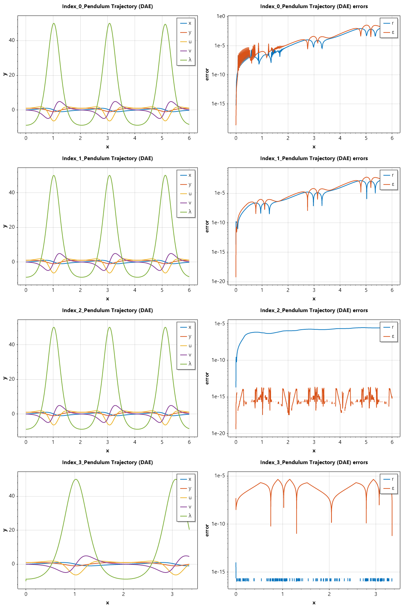

Differential Algebraic Equations
================================

1. Introduction to DAEs
-----------------------
Differential-Algebraic Equations are a class of functional equations that contain both differential equations (describing the evolution of the system) and algebraic constraints (restricting the state space). Unlike standard Ordinary Differential Equations (ODEs), DAEs are not explicitly solved for all derivatives.

A general DAE system is expressed in the implicit form: :math:`F(t, y, y') = 0`

If the Jacobian :math:`\cfrac{\partial F}{\partial y'}` is non-singular, the system is essentially an implicit ODE. If it is singular, the system is a "true" DAE.

2. The Concept of Index
-----------------------
The difficulty of solving a DAE is measured by its **index**. The most common definition is the **differentiation index**: the number of times you must differentiate the algebraic constraints to express the system as a set of explicit ODEs.

- **Index 0:** An ODE.
- **Index 1:** The most common solvable DAE (e.g., the algebraic variables can be solved for directly).
- **Higher Index (2+):** These are numerically unstable and usually require index reduction techniques before solving.

SepalSolver is able to get around this numerical instability of high index DAEs by using L-stable methods to solve them without the need for index reduction. 

3. Solving DAEs with `sepalsolver`
----------------------------------
In modern computational environments like C#, DAEs can be solved using the `SepalSolver` library, which utilizes a Mass Matrix formulation:
:math:`M y' = f(t, y)`
Where :math:`M` is a singular matrix.

---

4. Examples and Applications
----------------------------

.. admonition:: Example 1 : 

   **Example 1: The Robertson Problem (Chemical Kinetics)**
   This is a classic stiff DAE representing the reaction of three species. It is an Index-1 DAE where the total mass is conserved via an algebraic constraint.
   
   
   
   .. code-block:: csharp
   
      ColVec robertson_f(double t, ColVec y) =>
          [-0.04 * y[0] + 1e4 * y[1] * y[2],
           0.04 * y[0] - 1e4 * y[1] * y[2] - 3e7 * y[1]*y[1],
           y[0] + y[1] + y[2] - 1.0];
   
      Matrix mass_f = Diag([1, 1, 0]);
      double[] y0 = [1.0, 0.0, 0.0];
      (ColVec T, Matrix Y) = Ode43a(robertson_f, mass_f, y0, Logspace(-6,6.6));
      
      // Plot the result
      Y[.., 1] = 1e4*Y[.., 1];
      SemiLogx(T, Y);
      Xlabel("Time t"); Ylabel("Soluton y");
      Legend(["y_1", "1e4*y_2", "y_3"], MiddleLeft);
      Title("Solution of Robertson's ODE with ODE43a");
      SaveAs("Robertson-ODE-given-points-Ode43a.png");
   
   
   .. figure:: images/Robertson-ODE-given-points-Ode43a.png
      :align: center
      :alt: Robertson-ODE-given-points-Ode43a.png
   

.. admonition:: Example 1 :  The Simple Pendulum (Index-1)

   A pendulum in Cartesian coordinates is naturally an Index-3 DAE. We solve the stabilized Index-1 version by including velocity constraints.
   
   The position of the pendulum :math:`(x, y)` must satisfy the rigid rod constraint: 
   :math:`x^2 + y^2 - 1 = 0`
   
   **The Index-1 Formulation**
   To reduce the index, we differentiate the constraint twice. The second derivative introduces the accelerations :math:`x''` and :math:`y''`, allowing us to solve for the Lagrange multiplier :math:`\lambda` (tension).
   
   The resulting Index-1 system is:
   
   .. math::
   
      \begin{array}{rcl}
      x' &=& u \\
      y' &=& v \\
      u' &=& -\lambda x \\
      v' &=& -\lambda  y - g \\
      0 &=& u^2 + v^2 - y g - \lambda
      \end{array}    
   
   
   
   
   .. code-block:: csharp
   
      double g = 9.81;
   
      // State vector y = [x, y, u, v, λ]
      ColVec pendulum_f(double t, ColVec y) =>
          [y[2], 
           y[3], 
          -y[0] * y[4], 
          -y[1] * y[4] - g,
           y[2]*y[2] + y[3]*y[3] - y[1] * g - y[4]];
   
      Matrix mass_f = Diag([1, 1, 1, 1, 0]);
      double[] y0 = [0, 1, 1, 0, 1 - g];
      var opts = Odeset(Stats: true, RelTol: 1e-6);
      (ColVec T, Matrix Y) = Ode43a(pendulum_f, mass_f, y0, [0, 6], opts);
      Plot(T, Y, Linewidth: 2); Xlabel("x"); Ylabel("y");
      Legend(["x", "y", "u", "v", "λ"]);
      Title("Pendulum Trajectory (DAE)");
      SaveAs("Index_1-Pendulum-Problem-Ode43a.png");
   
   
   

Ouput

   
   .. terminal::
   
      Summary of statistics by Ode43a
              1054 successful steps
              12 failed attempts
              30416 function evaluations
              1066 partial derivatives
              4264 LU decompositions
              19739 solutions of linear systems
      
   
   .. figure:: images/Index_1-Pendulum-Problem-Ode43a.png
      :align: center
      :alt: Index_1-Pendulum-Problem-Ode43a.png
   

As an exercise, the reader is encouraged to solve the problem using 
this initial condition y0 = [1, 0, 0, 1, 1];

.. admonition:: Example 2 :  Semi-Explicit DAE (The Transistor Amplifier)**

   This example mimics the "hbdae" problem from MathWorks, representing an electrical circuit with nonlinear components.
   
   The transistor amplifier circuit contains six resistors, three capacitors, and a transistor.
   
   .. figure:: images/Transistor.png
       :align: center
       :alt: Transistor.png
   
   - The initial voltage signal is :math:`U_e(t) = 0.4\sin(200\pi t)`.
   - The operating voltage is :math:`U_b = 6`.
   - The voltages at the nodes are given by: :math:`U_i(t)(i = 1, 2, 3, 4, 5)`.
   - The values of the resistors  :math:`R_i(t)(i = 1, 2, 3, 4, 5)`. are constant, and the current through each resistor satisfies :math:`I = U/R`.
   - The values of the capacitors :math:`C_i(i = 1, 2, 3)` are constant, and the current through each capacitor satisfies :math:`I=C⋅dU/dt`.
   
   The goal is to solve for the output voltage through node 5, :math:`U_5(t)`.
   Using Kirchoff's law to equalize the current through each node (1 through 5), you can obtain a system of five equations describing the circuit:
   
   Node 1: :math:`C_1(U'_2 - U'_1) = (U_1 - U_e(t))/R_0`
   
   Node 2: :math:`C_1(U'_1 - U'_2) = (U_2 - U_b)/R_1 + U_2/R_2 + 0.01f(U_2 - U_3)`
   
   Node 3: :math:`-C_2U'_3 = U_3/R_3 - f(U_2 - U_3)`
   
   Node 4: :math:`C_3(U'_5 - U'_4) = (U_4 - U_b)/R_4 + 0.99f(U_2 - U_3)`
   
   Node 5: :math:`C_3(U'_4 - U'_5) = U_5/R_5`
   
   By extracting the coeeficients of the derivatives into a matrix, we have:
   
   .. math::
   
      \begin{pmatrix}
      -c_{1} &  c_{1} &     0    &    0     &     0    \\
      c_{1} & -c_{1} &     0    &    0     &     0    \\
      0    &   0    & -c_{ 2}  &    0     &     0    \\
      0    &   0    &    0     & -c_{ 3}  &  c_{ 3}  \\
      0    &   0    &    0     &  c_{ 3}  & -c_{ 3}
      \end{pmatrix}
      \begin{pmatrix}
      U'_1 \\  U'_2 \\ U'_3 \\ U'_4 \\ U'_5 
      \end{pmatrix} = 
      \begin{pmatrix}
      (U_1 - U_e(t))/R_0 \\  
      (U_2 - U_b)/R_1 + U_2/R_1 + 0.01f(U_2 - U_3) \\ 
      U_3/R_3 - f(U_2 - U_3) \\ 
      (U_4 - U_b)/R_4 + 0.99f(U_2 - U_3) \\ 
      U_5/R_5
      \end{pmatrix}
   
   
   
   .. code-block:: csharp
   
      double Ub = 6, R0 = 1000, R1 = 9000, R2 = R1, R3 = R2, R4 = R3, R5 = R4, 
          alpha = 0.99, beta = 1e-6, Uf = 0.026, c1 = 1e-6, c2 = 2e-6, c3 = 3e-6;
      Matrix Mass = new double[,]
      {
          {-c1,  c1,   0,   0,   0},
          { c1, -c1,   0,   0,   0},
          {  0,   0, -c2,   0,   0},
          {  0,   0,   0, -c3,  c3},
          {  0,   0,   0,  c3, -c3}
      };
   
      double Ue(double t) => 0.4 * Sin(200 * pi * t);
      double f(double du) => beta * (Exp(du / Uf) - 1);
      ColVec dudt(double t, ColVec u) =>
          [(u[0] -  Ue(t)) / R0,
           (u[1] - Ub) / R1 + u[1] / R2 +  (1 - alpha) * f(u[1] - u[2]),
           u[2]/R3 - f(u[1] - u[2]),
           (u[3] - Ub) / R4 + alpha * f(u[1] - u[2]), 
           u[4] / R5];
      
      double[] tspan = [0, 0.1];
      double[] y0 = [0, Ub / 2, Ub / 2, Ub, 0];
   
      var opts = Odeset(Stats: true);
      (ColVec T, Matrix Y) = Ode43a(dudt, Mass, y0, tspan, opts);
      Scatter(T, Arrayfun(Ue, T), "o"); HoldOn();
      Plot(T, Y[.., 4], "--r"); HoldOff();
      Legend(["Input", "Output"], UpperLeft);
      Xlabel("Time t"); Ylabel("Solution y");
      Title("One Transistor Amplifier DAE Problem-Ode43a");
      SaveAs("One-Transistor-Amplifier-DAE-Problem-Ode43a.png");
   
   
   

Ouput

   
   .. terminal::
   
      Summary of statistics by Ode43a
              305 successful steps
              90 failed attempts
              7769 function evaluations
              395 partial derivatives
              1551 LU decompositions
              3832 solutions of linear systems
      
   
   .. figure:: images/One-Transistor-Amplifier-DAE-Problem-Ode43a.png
      :align: center
      :alt: One-Transistor-Amplifier-DAE-Problem-Ode43a.png
   

.. admonition:: Example 3 :  The Akzo Nobel Problem

   A high-dimensional DAE describing a chemical process with 6 differential and 2 algebraic equations. This tests the solver's ability to handle stiff systems with coupled variables.
   
   **Mathematical Description:**
   The system is defined by reaction rates :math:`r_i` and concentrations :math:`y_1, ..., y_8`:
   
   
   .. math::
   
      \begin{array}{rcl}
      r_1 &=& k_1 \cdot y_1^4 \cdot y_2^{0.5}\\
      r_2 &=& k_2 \cdot y_3 \cdot y_4 \\
      r_3 &=& k_2 / K \cdot y_1 \cdot y_5\\
      r_4 &=& k_3 \cdot y_1 \cdot y_4^2\\
      r_5 &=& k_4 \cdot y_6^2 \cdot y_2^{0.5}
      \end{array}
   
   
   The differential equations are:
   
   .. math::
   
      \begin{array}{rcl}
      y_1' &=& -2r_1 + r_2 - r_3 - r_4\\
      y_2' &=& -0.5r_1 - r_5 + 0.5F_{in}\\
      y_3' &=& r_1 - r_2 + r_3\\
      y_4' &=& -r_2 + r_3 - 2r_4\\
      y_5' &=& r_2 - r_3 + r_4\\
      y_6' &=& -r_5
      \end{array}
   
   
   The algebraic constraints (Equilibrium):
   
   .. math::
   
      \begin{array}{rcl}
      0 &=& y_1 \cdot y_3 - y_7\\
      0 &=& y_4 \cdot y_5 - y_8
      \end{array}
   
   
   
   .. code-block:: csharp
   
      double k1 = 18.7, k2 = 0.58, k3 = 0.09, k4 = 0.42, K = 34.4, Fin = 0.012;
      double r1(ColVec y) => k1 * Pow(y[0], 4) * Pow(y[1], 0.5);
      double r2(ColVec y) => k2 * y[2] * y[3];
      double r3(ColVec y) => (k2 / K) * y[0] * y[4];
      double r4(ColVec y) => k3 * y[0] * Pow(y[3], 2);
      double r5(ColVec y) => k4 * Pow(y[5], 2) * Pow(y[1], 0.5);
   
      ColVec akzo_f(double t, ColVec y) =>
          [
              -2*r1(y) + r2(y) - r3(y) - r4(y),
              -0.5*r1(y) - r5(y) + 0.5*Fin,
              r1(y) - r2(y) + r3(y),
              -r2(y) + r3(y) - 2*r4(y),
              r2(y) - r3(y) + r4(y),
              -r5(y),
              y[0] * y[2] - y[6],
              y[3] * y[4] - y[7]
          ];
   
      Matrix mass_f = Diag([1, 1, 1, 1, 1, 1, 0, 0]);
      double[] y0 = [0.444, 0.0012, 0.0, 0.0037, 0.0, 0.0, 0.0, 0.0];
      (ColVec T, Matrix Y) = Ode43a(akzo_f, mass_f, y0, [0, 180]);
      Plot(T, Y); Axis([0, 180, -0.01, 0.5]);
      Xlabel("Time"); Ylabel("Concentration");
      Title("Akzo Nobel Chemical Kinetics (DAE)");
      SaveAs("Akzo-Nobel-Ode43a.png");
   
   
   .. figure:: images/Akzo-Nobel-Ode43a.png
      :align: center
      :alt: Akzo-Nobel-Ode43a.png
   

Index-2 DAE
-----------
Most DAE solvers usually avoid solving DAEs in index 2 form. But SepalSolver is able to handle most index 2 DAEs to a relative tolerance of :math:`10^{-4}`.

Now we look at examples of index 2 DAEs

.. admonition:: Example 4 :  

   Usnig the example from "On the numerical solution of differential–algebraic equations with index-2" by Ercan Celık
   
   .. math::
   
      \begin{align}
      x'_1 &= \left(\alpha - \cfrac{1}{2 - t}\right)x_1 + (2 - t)\alpha z + \cfrac{3 - t}{2 - t}x_2 \\
      x'_2 &= \cfrac{1 - \alpha}{t - 2} x_1 - x_2 + (\alpha - 1)z + 2e^t \\
      0 &= (t + 2)x_1 + (t^2 - 4)x_2 - (t^2 + t - 2)e^t
      \end{align}
   
   
   Intial condition: :math:`x_1(0) = 1, x_2(0) = 1`;
   
   SepalSolver has the ability to compute consistent initial conditions for index 2 DAEs, so we can solve this problem without manually differentiating the algebraic constraint.
   
   
   .. code-block:: csharp
   
      // define the DAE
      double alpha = 10;
      ColVec Ercan(double t, ColVec x) =>
          [ (alpha - 1/(2-t))*x[0] + (2-t)*alpha*x[2] + (3-t)/(2-t)*x[1],
            (1-alpha)/(t-2)*x[0] - x[1] + (alpha-1)*x[2] + 2*Exp(t),
            (t+2)*x[0] + (t*t-4)*x[1] - (t*t+t-2)*Exp(t) ];
   
      Matrix mass_f = Diag([1, 1, 0]);
      double[] y0 = [1, 1, 0]; // only the differential variables need initial conditions
      var opts = Odeset(Stats: true);
      (ColVec T, Matrix Y) = Ode43a(Ercan, mass_f, y0, Linspace(0,1,21), opts);
      Scatter(T, Hcart(Exp(T), Exp(T), -Exp(T).Div(2-T)), "o"); HoldOn();
      Plot(T, Y); HoldOff();
      Xlabel("Time t"); Ylabel("Solution x");
      Legend(["x_1_Exact", "x_2_Exact", "z_Exact", "x_1_NumSol", "x_2_NumSol", "z_NumSol"], MiddleRight);
      Title("Index-2 DAE Example (Ercan Celık)");
      SaveAs("Index-2-DAE-Ercan-Celik.png");
   
      // We can actually print out the result to compare with the analytical solution
      Console.WriteLine("""
               t   ||  x_1_NumSol(t)  |  x_1_Exact(t)  ||  x_2_NumSol(t)  |  x_2_Exact(t)  ||   z_NumSol(t)   |   z_Exact(t) 
          ---------++-----------------+----------------++-----------------+----------------++-----------------+---------------
          """);
      for (int i = 0; i < T.Numel; i++)
      {
          Console.WriteLine($"""
                {T[i]:F3}  ||     {Y[i, 0]:F6}    |    {Exp(T[i]):F6}    ||     {Y[i, 1]:F6}    |    {Exp(T[i]):F6}    ||     {Y[i, 2]:F6}   |  {-Exp(T[i])/(2-T[i]):F6}
              """);
      }
   
      // We can compute the solution to a higher accuracy 
      Console.WriteLine("\n\nNow we compute the solution to a higher accuracy (RelTol = 1e-5):\n");
      opts = Odeset(Stats: true, RelTol: 1e-5);
      (T, Y) = Ode43a(Ercan, mass_f, y0, Linspace(0, 1, 21), opts);
      Console.WriteLine("""
               t   ||  x_1_NumSol(t)  |  x_1_Exact(t)  ||  x_2_NumSol(t)  |  x_2_Exact(t)  ||   z_NumSol(t)   |   z_Exact(t) 
          ---------++-----------------+----------------++-----------------+----------------++-----------------+---------------
          """);
      for (int i = 0; i < T.Numel; i++)
      {
          Console.WriteLine($"""
                {T[i]:F3}  ||     {Y[i, 0]:F6}    |    {Exp(T[i]):F6}    ||     {Y[i, 1]:F6}    |    {Exp(T[i]):F6}    ||     {Y[i, 2]:F6}   |  {-Exp(T[i])/(2-T[i]):F6}
              """);
      }
   
   
   

Ouput

   
   .. terminal::
   
      Summary of statistics by Ode43a
              40 successful steps
              0 failed attempts
              1239 function evaluations
              40 partial derivatives
              160 LU decompositions
              905 solutions of linear systems
      
           t   ||  x_1_NumSol(t)  |  x_1_Exact(t)  ||  x_2_NumSol(t)  |  x_2_Exact(t)  ||   z_NumSol(t)   |   z_Exact(t) 
      ---------++-----------------+----------------++-----------------+----------------++-----------------+---------------
        0.000  ||     1.000000    |    1.000000    ||     1.000000    |    1.000000    ||     -0.500000   |  -0.500000
        0.050  ||     1.051268    |    1.051271    ||     1.051270    |    1.051271    ||     -0.539164   |  -0.539113
        0.100  ||     1.105167    |    1.105171    ||     1.105169    |    1.105171    ||     -0.581664   |  -0.581669
        0.150  ||     1.161830    |    1.161834    ||     1.161832    |    1.161834    ||     -0.628013   |  -0.628019
        0.200  ||     1.221399    |    1.221403    ||     1.221400    |    1.221403    ||     -0.678551   |  -0.678557
        0.250  ||     1.284021    |    1.284025    ||     1.284023    |    1.284025    ||     -0.733722   |  -0.733729
        0.300  ||     1.349855    |    1.349859    ||     1.349856    |    1.349859    ||     -0.794028   |  -0.794035
        0.350  ||     1.419063    |    1.419068    ||     1.419065    |    1.419068    ||     -0.860034   |  -0.860041
        0.400  ||     1.491821    |    1.491825    ||     1.491822    |    1.491825    ||     -0.932383   |  -0.932390
        0.450  ||     1.568308    |    1.568312    ||     1.568310    |    1.568312    ||     -1.011807   |  -1.011814
        0.500  ||     1.648717    |    1.648721    ||     1.648719    |    1.648721    ||     -1.099140   |  -1.099148
        0.550  ||     1.733249    |    1.733253    ||     1.733250    |    1.733253    ||     -1.195339   |  -1.195347
        0.600  ||     1.822115    |    1.822119    ||     1.822116    |    1.822119    ||     -1.301506   |  -1.301513
        0.650  ||     1.915537    |    1.915541    ||     1.915538    |    1.915541    ||     -1.418911   |  -1.418919
        0.700  ||     2.013750    |    2.013753    ||     2.013750    |    2.013753    ||     -1.549033   |  -1.549041
        0.750  ||     2.116997    |    2.117000    ||     2.116998    |    2.117000    ||     -1.693592   |  -1.693600
        0.800  ||     2.225538    |    2.225541    ||     2.225539    |    2.225541    ||     -1.854610   |  -1.854617
        0.850  ||     2.339645    |    2.339647    ||     2.339645    |    2.339647    ||     -2.034469   |  -2.034476
        0.900  ||     2.459601    |    2.459603    ||     2.459601    |    2.459603    ||     -2.235997   |  -2.236003
        0.950  ||     2.585708    |    2.585710    ||     2.585708    |    2.585710    ||     -2.462576   |  -2.462581
        1.000  ||     2.718281    |    2.718282    ||     2.718281    |    2.718282    ||     -2.718279   |  -2.718282
      
      
      Now we compute the solution to a higher accuracy (RelTol = 1e-5):
      
      Summary of statistics by Ode43a
              41 successful steps
              0 failed attempts
              1495 function evaluations
              41 partial derivatives
              164 LU decompositions
              1153 solutions of linear systems
      
           t   ||  x_1_NumSol(t)  |  x_1_Exact(t)  ||  x_2_NumSol(t)  |  x_2_Exact(t)  ||   z_NumSol(t)   |   z_Exact(t) 
      ---------++-----------------+----------------++-----------------+----------------++-----------------+---------------
        0.000  ||     1.000000    |    1.000000    ||     1.000000    |    1.000000    ||     -0.500000   |  -0.500000
        0.050  ||     1.051269    |    1.051271    ||     1.051270    |    1.051271    ||     -0.539110   |  -0.539113
        0.100  ||     1.105168    |    1.105171    ||     1.105169    |    1.105171    ||     -0.581665   |  -0.581669
        0.150  ||     1.161831    |    1.161834    ||     1.161832    |    1.161834    ||     -0.628014   |  -0.628019
        0.200  ||     1.221399    |    1.221403    ||     1.221401    |    1.221403    ||     -0.678552   |  -0.678557
        0.250  ||     1.284022    |    1.284025    ||     1.284023    |    1.284025    ||     -0.733724   |  -0.733729
        0.300  ||     1.349855    |    1.349859    ||     1.349857    |    1.349859    ||     -0.794029   |  -0.794035
        0.350  ||     1.419064    |    1.419068    ||     1.419065    |    1.419068    ||     -0.860035   |  -0.860041
        0.400  ||     1.491821    |    1.491825    ||     1.491822    |    1.491825    ||     -0.932384   |  -0.932390
        0.450  ||     1.568309    |    1.568312    ||     1.568310    |    1.568312    ||     -1.011808   |  -1.011814
        0.500  ||     1.648718    |    1.648721    ||     1.648719    |    1.648721    ||     -1.099141   |  -1.099148
        0.550  ||     1.733250    |    1.733253    ||     1.733251    |    1.733253    ||     -1.195341   |  -1.195347
        0.600  ||     1.822116    |    1.822119    ||     1.822116    |    1.822119    ||     -1.301507   |  -1.301513
        0.650  ||     1.915538    |    1.915541    ||     1.915539    |    1.915541    ||     -1.418913   |  -1.418919
        0.700  ||     2.013750    |    2.013753    ||     2.013751    |    2.013753    ||     -1.549034   |  -1.549041
        0.750  ||     2.116997    |    2.117000    ||     2.116998    |    2.117000    ||     -1.693594   |  -1.693600
        0.800  ||     2.225539    |    2.225541    ||     2.225539    |    2.225541    ||     -1.854611   |  -1.854617
        0.850  ||     2.339645    |    2.339647    ||     2.339645    |    2.339647    ||     -2.034470   |  -2.034476
        0.900  ||     2.459602    |    2.459603    ||     2.459602    |    2.459603    ||     -2.235998   |  -2.236003
        0.950  ||     2.585708    |    2.585710    ||     2.585709    |    2.585710    ||     -2.462576   |  -2.462581
        1.000  ||     2.718281    |    2.718282    ||     2.718281    |    2.718282    ||     -2.718279   |  -2.718282
   
   .. figure:: images/Index-2-DAE-Ercan-Celik.png
      :align: center
      :alt: Index-2-DAE-Ercan-Celik.png
   
   
   

.. admonition:: Example 5 :  Pendulum position constraint (Index-2)

   To reduce the index, if we differentiated the constraint once instead of twice, we end up with index 2 problem. 
   
   The resulting Index-1 system is:
   
   .. math::
   
      \begin{array}{rcl}
      x' &=& u \\
      y' &=& v \\
      u' &=& -\lambda x \\
      v' &=& -\lambda  y - g \\
      0 &=& x u + y v
      \end{array}    
   
   
   
   
   .. code-block:: csharp
   
      double g = 9.81;
   
      // State vector y = [x, y, u, v, λ]
      ColVec pendulum_f(double t, ColVec y) =>
          [y[2],
           y[3],
           -y[0] * y[4],
           -y[1] * y[4] - g,
           y[0]*y[2] + y[1]*y[3]];
   
      Matrix mass_f = Diag([1, 1, 1, 1, 0]);
      double[] y0 = [0, 1, 1, 0, -1];
      var opts = Odeset(Stats: true);
      (ColVec T, Matrix Y, _) = Ode43a(pendulum_f, mass_f, y0, Linspace(0, 6, 51), opts);
      Plot(T, Y, Linewidth: 2); Xlabel("x"); Ylabel("y");
      Legend(["x", "y", "u", "v", "λ"]);
      Title("Pendulum Trajectory (DAE)");
      SaveAs("Index_2-Pendulum-Problem-Ode43a.png");
   
      Console.WriteLine("\n\n");
      Console.WriteLine(Hcart(T, Y));
   
   
   
   

Ouput

   
   .. terminal::
   
      Summary of statistics by Ode43a
              548 successful steps
              468 failed attempts
              31289 function evaluations
              1016 partial derivatives
              3198 LU decompositions
              21978 solutions of linear systems
      
      
      
      
      
         0.0000   -0.0000    1.0000    1.0000    0.0000   -8.8100
         0.1200    0.1225    0.9925    1.0633   -0.1313   -8.5828
         0.2400    0.2601    0.9656    1.2499   -0.3367   -7.7862
         0.3600    0.4265    0.9045    1.5333   -0.7230   -5.9818
         0.4800    0.6278    0.7784    1.8001   -1.4518   -2.2555
         0.6000    0.8446    0.5355    1.7030   -2.6858    4.8888
         0.7200    0.9929    0.1193    0.5099   -4.2451   17.1258
         0.8400    0.8946   -0.4470   -2.4231   -4.8497   33.7706
         0.9600    0.3923   -0.9199   -5.7200   -2.4395   47.6667
         1.0800   -0.3463   -0.9382   -5.8607    2.1632   48.2034
         1.2000   -0.8744   -0.4853   -2.6645    4.8004   34.8941
         1.3200   -0.9964    0.0852    0.3707    4.3374   18.1265
         1.4400   -0.8580    0.5138    1.6680    2.7854    5.5276
         1.5600   -0.6421    0.7666    1.8109    1.5168   -1.9047
         1.6800   -0.4388    0.8987    1.5539    0.7587   -5.8053
         1.8000   -0.2701    0.9629    1.2666    0.3553   -7.7014
         1.9200   -0.1309    0.9915    1.0724    0.1416   -8.5478
         2.0400   -0.0078    1.0000    1.0009    0.0078   -8.8024
         2.1600    0.1143    0.9935    1.0560   -0.1215   -8.6098
         2.2800    0.2506    0.9682    1.2350   -0.3197   -7.8604
         2.4000    0.4148    0.9100    1.5141   -0.6902   -6.1402
         2.5200    0.6141    0.7894    1.7888   -1.3917   -2.5754
         2.6400    0.8315    0.5557    1.7324   -2.5921    4.2953
         2.7600    0.9886    0.1514    0.6360   -4.1532   16.1813
         2.8800    0.9123   -0.4098   -2.1937   -4.8838   32.6752
         3.0000    0.4355   -0.9003   -5.5702   -2.6946   47.0867
         3.1200   -0.3010   -0.9537   -5.9811    1.8875   48.6527
         3.2400   -0.8531   -0.5219   -2.8990    4.7391   35.9661
         3.3600   -0.9988    0.0516    0.2286    4.4225   19.1117
         3.4800   -0.8707    0.4921    1.6297    2.8832    6.1624
         3.6000   -0.6561    0.7548    1.8199    1.5818   -1.5608
         3.7200   -0.4507    0.8928    1.5737    0.7945   -5.6334
         3.8400   -0.2798    0.9602    1.2831    0.3739   -7.6175
         3.9600   -0.1391    0.9904    1.0817    0.1519   -8.5132
         4.0800   -0.0153    1.0000    1.0022    0.0154   -8.7982
         4.2000    0.1065    0.9945    1.0494   -0.1124   -8.6340
         4.3200    0.2415    0.9706    1.2209   -0.3038   -7.9272
         4.4400    0.4037    0.9151    1.4956   -0.6599   -6.2865
         4.5600    0.6010    0.7995    1.7766   -1.3355   -2.8718
         4.6800    0.8187    0.5746    1.7569   -2.5032    3.7417
         4.8000    0.9835    0.1817    0.7505   -4.0617   15.2887
         4.9200    0.9278   -0.3736   -1.9753   -4.9046   31.6110
         5.0400    0.4762   -0.8796   -5.4127   -2.9302   46.4732
         5.1600   -0.2564   -0.9668   -6.0821    1.6130   49.0350
         5.2800   -0.8309   -0.5567   -3.1265    4.6663   36.9868
         5.4000   -1.0000    0.0186    0.0838    4.5004   20.0813
         5.5200   -0.8826    0.4705    1.5879    2.9790    6.8006
         5.6400   -0.6696    0.7430    1.8271    1.6467   -1.2077
         5.7600   -0.4625    0.8869    1.5928    0.8306   -5.4629
         5.8800   -0.2894    0.9574    1.2993    0.3927   -7.5324
         6.0000   -0.1471    0.9893    1.0910    0.1622   -8.4775
      
   
   .. figure:: images/Index_2-Pendulum-Problem-Ode43a.png
      :align: center
      :alt: Index_2-Pendulum-Problem-Ode43a.png
   
   
   Observe that the initial condition supplied for :math:`\lambda` was :math:`-1`; but the result returned shown that the correct initial condition for the algebraic variable :math:`\lambda` is :math:`-8.81`.
   Sending in a wrong initial condition was done on purpose, to test the ability of sepalsolver to compute the initial condition of the algebraic variable. 
   

.. admonition:: Example 6 :  Constrained Multibody System (Gear-Gupta-Leimkuhler Formulation)

   Here we look at a constrained multibody system presented in "Approximate Analytical Solution of Index-2 DAEs Arising from Constrained Multibody Systems" by Brahim Benhammouda.
   
   The equations of motion for constrained mechanical multibody systems in the stabilized Gear-Gupta-Leimkuhler (GGL) form are given by:
   
   .. math::
   
      \begin{cases}
      u' = v - G^T(u)\mu, \\
      M(u)v' = f(u, v) - G^T(u)\lambda, \\
      0 = g(u), \\
      0 = G(u)v
      \end{cases}
   
   
   This model describes a two-link planar robotic manipulator where:
   
   .. math::
   
      \begin{aligned}
      M(u) &= \begin{pmatrix} 5 + 3\cos(u_2) & 1 + 1.5\cos(u_2) \\ 1 + 1.5\cos(u_2) & 1 \end{pmatrix}, \\
      f(u, v) &= \begin{pmatrix} v_1\cos(u_1) + v_1\cos(u_1 + u_2) - 3u_1 \\ v_1\cos(u_1 + u_2) + (1 - 1.5\cos(u_2))u_1 \end{pmatrix}, \\
      g(u) &= \sin(u_1) + \sin(u_1 + u_2), \\
      G(u) &= \begin{pmatrix} \cos(u_1) + \cos(u_1 + u_2) & \cos(u_1 + u_2) \end{pmatrix}
      \end{aligned}
   
   
   The physical initial conditions are:
   :math:`u(0) = (0, 0)^T, \quad v(0) = (1, -2)^T`
   
   Because the mass matrix :math:`M(u)` is state-dependent, we formulate the mass matrix as a function of the state vector :math:`y`, yielding a state-dependent singular mass matrix :math:`\mathcal{M}(t, y) y' = F(t, y)`.
   
   
   .. code-block:: csharp
   
      Matrix M(ColVec u) => new double[,]
      {
          { 5 + 3 * Cos(u[1]), 1 + 1.5 * Cos(u[1]) },
          { 1 + 1.5 * Cos(u[1]), 1 },
      };
   
      ColVec f(ColVec u, ColVec v) => [
          v[0] * Cos(u[0]) + v[0] * Cos(u[0] + u[1]) - 3 * u[0],
          v[0] * Cos(u[0] + u[1]) + (1 - 1.5 * Cos(u[1])) * u[0],
      ];
   
      double g(ColVec u) => Sin(u[0]) + Sin(u[0] + u[1]);
      RowVec G(ColVec u) => [Cos(u[0]) + Cos(u[0] + u[1]), Cos(u[0] + u[1])];
   
      Matrix Mass(double t, ColVec y)
      {
          ColVec u = y[0..2];
          Matrix mass = Zeros(6, 6);
          mass[0..2, 0..2] = Eye(2);
          mass[2..4, 2..4] = M(u);
          return mass;
      }
   
      ColVec Fun(double t, ColVec y)
      {
          ColVec u = y[0..2], v = y[2..4], µ = y[4], λ = y[5];
          return [.. (v - G(u).T * µ), .. (f(u, v) - G(u).T * λ), g(u), G(u) * v];
      }
   
      var opts = Odeset(Stats: true, RelTol: 1e-5);
      (ColVec T, Matrix Y) = Ode43a(Fun, Mass, [0, 0, 1, -2, 0, 1], [0, 20], opts);
   
      var plt = Plot(T, Y, Linewidth: 2); AspectRatio(1, 1.5);
      Title("Constrained Mechanical System Index 2 DAE Problem");
      Xlabel("Time t"); Ylabel("Solution z");
      Legend(["u1", "u2", "v1", "v2", "µ", "λ"]);
      SaveAs("Constrained_Mechanical_System_Index_2_DAE.png", 1000, 500);
   
   
   

Ouput

   
   .. terminal::
   
      Summary of statistics by Ode43a
              691 successful steps
              436 failed attempts
              40849 function evaluations
              1127 partial derivatives
              4085 LU decompositions
              28859 solutions of linear systems
      
   
   .. figure:: images/Constrained_Mechanical_System_Index_2_DAE.png
      :align: center
      :alt: Constrained_Mechanical_System_Index_2_DAE.png
   

<header> Solving Index 3 </header>
To show more capability of the sepalsolver with higher index DAEs, we present this solution of the Pendulum equation from index 0 to index 3 below

% --- Index 0 ---

.. math::

   \begin{array}{rcl}
   \dot{x} &= u \\
   \dot{y} &= v \\
   \dot{u} &= -x \lambda \\
   \dot{v} &= -y \lambda - g \\
   \dot{\lambda} &= -2\lambda(xu + yv) - 3gv
   \end{array}

% --- Index 1 ---

.. math::

   \begin{array}{rcl}
   \dot{x} &= u \\
   \dot{y} &= v \\
   \dot{u} &= -x \lambda \\
   \dot{v} &= -y \lambda - g \\
   0 &= u^2 + v^2 - y g - \lambda
   \end{array}

% --- Index 2 ---

.. math::

   \begin{array}{rcl}
   \dot{x} &= u \\
   \dot{y} &= v \\
   \dot{u} &= -x \lambda \\
   \dot{v} &= -y \lambda - g \\
   0 &= x u + y v
   \end{array}

% --- Index 3 ---

.. math::

   \begin{array}{rcl}
   \dot{x} &= u \\
   \dot{y} &= v \\
   \dot{u} &= -x \lambda \\
   \dot{v} &= -y \lambda - g \\
   0 &= x^2 + y^2 - 1
   \end{array}

The result is assessed using these errors

.. math::

   \begin{array}{rcl}
   r &= |x^2 + y^2 - 1| \\
   \epsilon &= |xu + yv| 
   \end{array}

.. code-block:: csharp

   double g = 9.81; ColVec T; Matrix Y;
   double[] y0 = [0, 1, 1, 0, 1 - g], interval = Linspace(0, 6, 51);
   var opts = Odeset(Stats: true, RelTol: 1e-6);
   Matrix Mass = Diag([1, 1, 1, 1, 0]);
   Matrix Error(Matrix Y) => Hcart(Abs(Y[.., 0].Pow(2) + Y[.., 1].Pow(2) - 1),
                                   Abs(Y[.., 0].Times(Y[.., 2]) + Y[.., 1].Times(Y[.., 3])));
   void ResultPloter(ColVec T, Matrix Y, int index)
   {
       Subplot(4, 2, 2 * index);
       Plot(T, Y, Linewidth: 2); GridOn();
       Xlabel("x"); Ylabel("y");
       Legend(["x", "y", "u", "v", "λ"]);
       Title($"Index_{index}_Pendulum Trajectory (DAE)");

       Subplot(4, 2, 2 * index + 1);
       SemiLogy(T, Error(Y), Linewidth: 2); GridOn();
       Xlabel("x"); Ylabel("error");
       Legend(["r", "ε"]);
       Title($"Index_{index}_Pendulum Trajectory (DAE) errors");
   }

   // Index 0
   (T, Y) = Ode45((t, y) => [y[2], y[3], -y[0] * y[4], -y[1] * y[4] - g,
           -2 * y[4] * (y[0] * y[2] + y[1] * y[3]) - 3 * g * y[3]],
           y0, interval, opts); ResultPloter(T, Y, 0);
   // Index 1
   (T, Y) = Ode43a((t, y) => [y[2], y[3], -y[0] * y[4], -y[1] * y[4] - g,
            y[2]*y[2] + y[3]*y[3] - y[1] * g - y[4]], Mass, 
            y0, interval, opts); ResultPloter(T, Y, 1);
   // Index 2
   (T, Y) = Ode43a((t, y) => [y[2], y[3], -y[0] * y[4], -y[1] * y[4] - g,
            y[0]*y[2] + y[1]*y[3]], Mass, 
            y0, interval, opts); ResultPloter(T, Y, 2);
   // Index 3
   (T, Y) = Ode43a((t, y) => [y[2], y[3], -y[0] * y[4], -y[1] * y[4] - g,
            y[0]*y[0] + y[1]*y[1] - 1], Mass, 
            y0, interval, opts); ResultPloter(T, Y, 3);

   SaveAs("Pendulum-Problem-Ode43a.png", 1200, 1800);
   CloseFig();

Ouput

.. terminal::

   Summary of statistics by Ode45
           220 successful steps
           21 failed attempts
           1447 function evaluations
   
   Summary of statistics by Ode43a
           1082 successful steps
           47 failed attempts
           32151 function evaluations
           1129 partial derivatives
           4516 LU decompositions
           20845 solutions of linear systems
   
   Summary of statistics by Ode43a
           871 successful steps
           50 failed attempts
           34084 function evaluations
           921 partial derivatives
           3654 LU decompositions
           24887 solutions of linear systems
   
   Summary of statistics by Ode43a
           8772 successful steps
           71 failed attempts
           284560 function evaluations
           8843 partial derivatives
           35372 LU decompositions
           196112 solutions of linear systems
   

