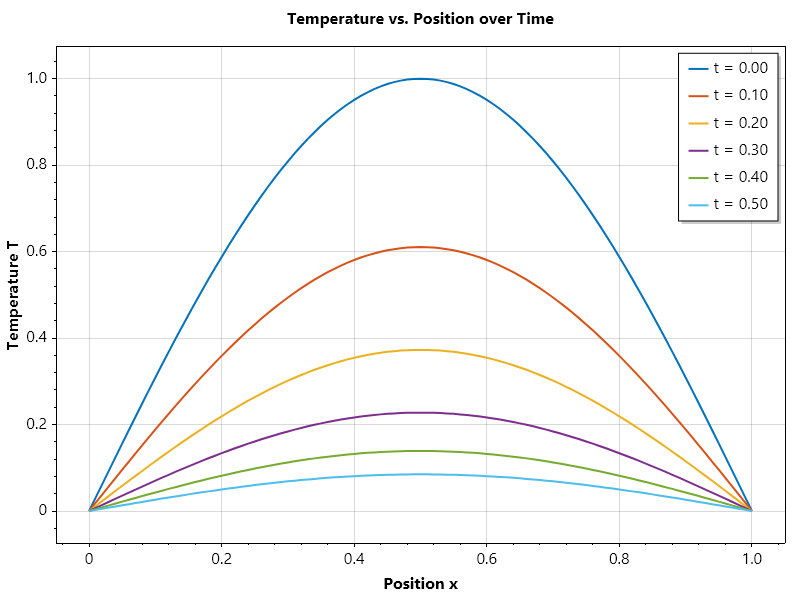
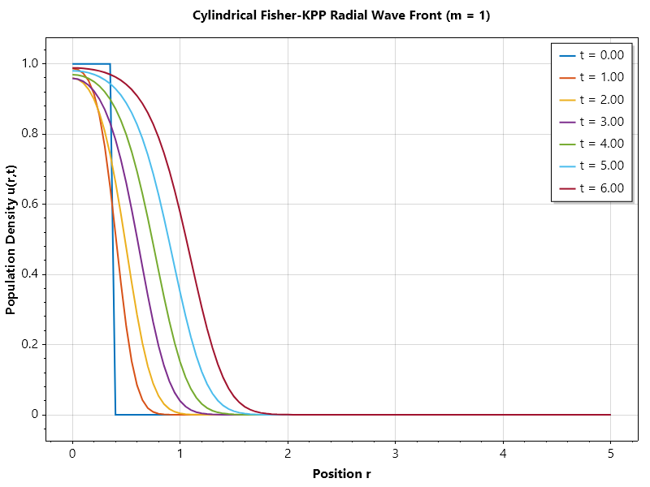
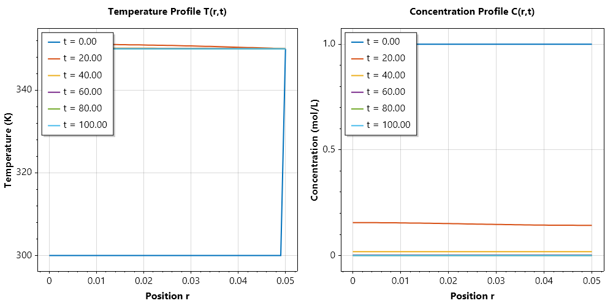
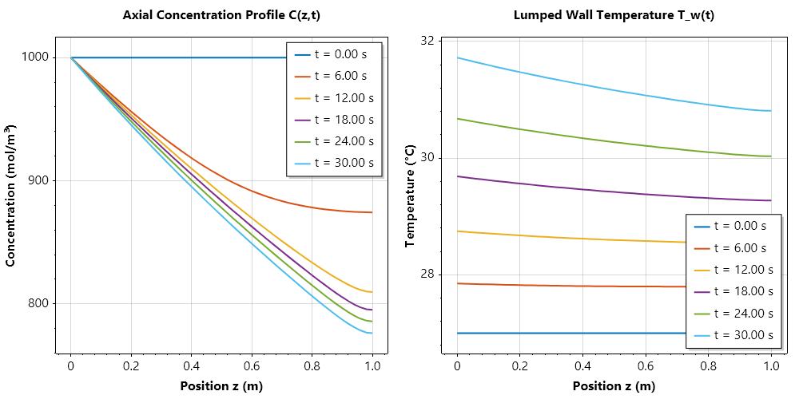
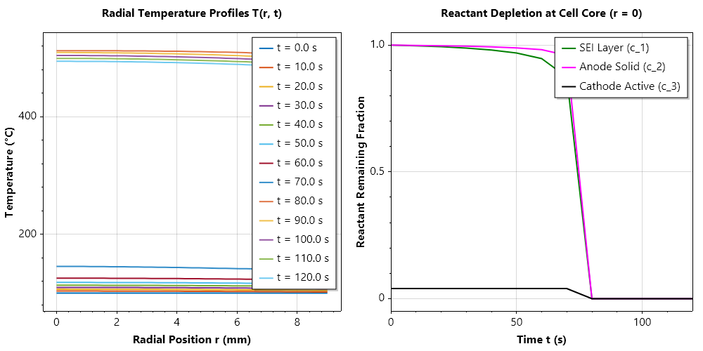
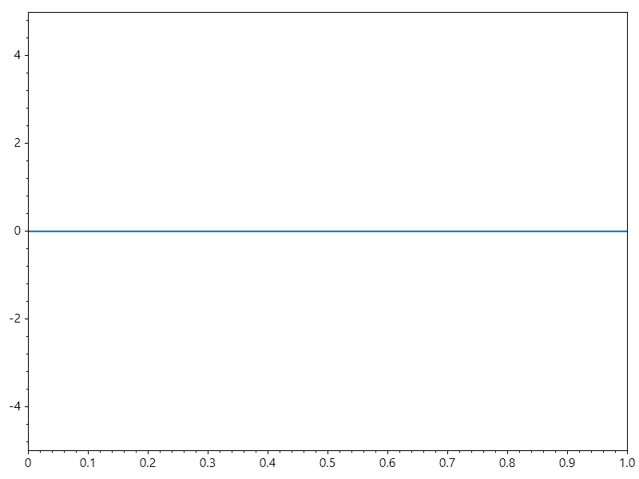
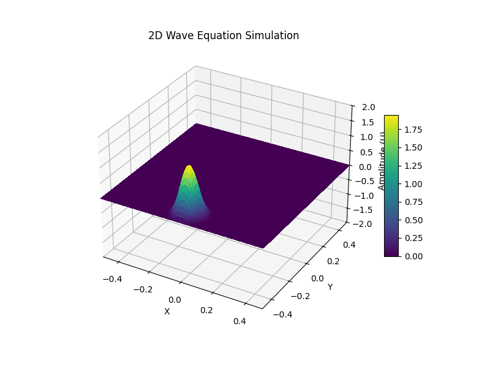

Solution Of PDE by Method of Lines
==================================

The **Method of Lines (MOL)** is a powerful numerical technique used to solve partial differential equations (PDEs), particularly those that are time-dependent (evolutionary).

Instead of discretizing all dimensions(space and time) simultaneously, the core idea is to discretize the spatial variables while leaving the time variable continuous. This transforms a single PDE into a system of coupled **Ordinary Differential Equations(ODEs)**.

How It Works: The 3-Step Process
^^^^^^^^^^^^^^^^^^^^^^^^^^^^^^^^

Imagine you are solving the heat equation: 

.. math::

   \frac{\partial u}{\partial t} = \alpha \frac{\partial^2 u}{\partial x^2}

1. **Spatial Discretization**: You divide the spatial domain into a grid of points(e.g., :math:`x_1, x_2, \cdot, x_n`). You replace the spatial derivatives :math:`(\frac{\partial^2 u}{\partial x^2})` with finite difference approximations, such as:

.. math::

   \frac{\partial^2 u}{\partial x^2} = \frac{u_{i+1} - 2u_i + u_{i-1}}{(\Delta x)^2}

2. **Conversion to ODEs**: By applying this at every grid point, the PDE becomes a set of ODEs, one for each point :

.. math::

   \frac{\partial u_i(t)}{\partial t} \approx \alpha \frac{u_{i+1}(t) - 2u_i(t) + u_{i-1}(t)}{(\Delta x)^2}

3. **Temporal Integration**: Now that you have a system of ODEs, you can use standard, high-performance ODE solvers like **Runge-Kutta** or **Euler’s method** to step forward in time.

Why Use It? (Advantages)
""""""""""""""""""""""""

- **Leverages Existing Tech**: You can use sophisticated, pre-built ODE solvers(like `Ode45`/`Ode43a` in SepalSolver or `ode45` in MATLAB) that automatically handle error control and adaptive time-stepping.
- **Flexibility**: You can use different spatial discretization methods, such as finite differences, finite elements, or spectral methods, depending on the geometry of your problem
- **Simplification**: It breaks a complex multi-dimensional problem into a more manageable "line-by-line" temporal evolution.

Limitations
"""""""""""

- **Stiffness**: The resulting system of ODEs is often "stiff," meaning you may need implicit solvers to avoid tiny, inefficient time steps.
- **Not for All PDEs**: It is designed for "evolutionary" problems (parabolic and hyperbolic). It cannot be used directly for purely "steady-state" elliptic equations(like Laplace’s equation) without adding a "pseudo-time" variable.

.. list-table:: Comparison at a Glance
   :header-rows: 1

   * - Feature
     - Standard Finite Difference(FDM)
     - Method of Lines(MOL)
   * - **Time Treatment**
     - Discretized at the start
     - Kept continuous initially
   * - **Solving Logic**
     - Solves the whole grid at once
     - Solves ODEs along "lines" of time
   * - **Software**
     - Requires custom time-stepping
     - Uses off-the-shelf ODE solvers

Parabolic and Ellipitic PDE Solver
^^^^^^^^^^^^^^^^^^^^^^^^^^^^^^^^^^
Sepalsolver provides an inbuilt numerical solution of parabolic and elliptic pde (Pdepe) built on 
our differential algebraic equation solver. These solvers are L-stable diagonally implicit Runge Kutta. 
This allows it to handle the boundary conditions implicitly and also correct the egde values in 
situation where the initial condition is not consitent with the boundary condition

.. math::

   x^m c\left(x,t,u,\frac{\partial u}{\partial x}\right) \frac{\partial \mathbf{u}}{\partial t} =  \frac{\partial}{\partial x}\left(x^m f\left(x,t, u,\frac{\partial u}{\partial x}\right)\right) + x^m s\left(x,t, u,\frac{\partial u}{\partial x}\right)

:math:`m` is the symmetry constant, which is 0 for cartesian cooridnate system, 1, for cylindrical coordinate system and 2 for spherical coordinate system  

In the foolwing example, we show how to use the Pdepe function to solve PDEs.

Example 1: Solving the Heat Equation
^^^^^^^^^^^^^^^^^^^^^^^^^^^^^^^^^^^^
Consider the one-dimensional heat equation:

.. math::

   \frac{\partial u}{\partial t} = \alpha \frac{\partial^2 u}{\partial x^2}

with initial condition :math:`u(x,0) = \sin(\pi x)` and boundary conditions :math:`u(0,t) = u(1,t) = 0`.

.. code-block:: csharp

   // SOLVE_HEAT_EQUATION Solves the 1D heat equation using pdepe
   // Equation:  du/dt = alpha * d^2u/dx^2
   // Domain:    x in [0, 1],  t in [0, 0.5]
   // IC:        u(x,0) = sin(π x)
   // BC:        u(0,t) = 0,  u(1,t) = 0
   //
   // 1. Model Parameters & Mesh Setup
   double alpha = 0.5;       // Thermal diffusivity coefficient
   int m = 0;                // 0 = Slab / Cartesian coordinates
   double L = 1;             // Length of the rod
   double t_final = 0.5;     // Final simulation time

   ColVec x = Linspace(0, L, 101);        // 51 spatial grid points
   double[] t = Linspace(0, t_final, 6);   // 6 time steps

   // 2. Defines the PDE components: c* du/ dt = x ^ (-m) * d / dx(x ^ m * f) + s
   (double c, double f, double s) pdefun(double x, double t, double u, double dudx) =>
       (1, alpha * dudx, 0);

   // 3. Initial sinusoidal temperature distribution
   double icfun(double x) => Sin(pi * x);

   // 4. Boundary Conditions defined as: p(x, t, u) + q(x, t) * f = 0
   (double pl, double ql, double pr, double qr) bcfun(double xl, double ul, double xr, double ur, double t) => (ul, 0, ur, 0);

   // 5. Solve the PDE
   (var T, var U) = Pdepe(m, pdefun, icfun, bcfun, x, t);

   // Subplot 2: 2D Temperature Profiles at Selected Times
   Plot(x, U, Linewidth: 2); GridOn();
   Xlabel("Position x"); Ylabel("Temperature T");
   Title("Temperature vs. Position over Time");
   Legend(T.Select(t => $"t = {t:0.00}"));
   SaveAs("Temperature.png");
   CloseFig();

Example 2: Solving Reactive Diffusion Equation
^^^^^^^^^^^^^^^^^^^^^^^^^^^^^^^^^^^^^^^^^^^^^^
The Fisher-KPP reaction-diffusion model transformed into a cylindrical coordinate system (:math:`m = 1`).
In cylindrical coordinates, the model represents radial population dispersion or chemical wavefront propagation 
outward from a central core (e.g., cell growth in a Petri dish or cylindrical tissue scaffold).

.. math::

   \frac{\partial u}{\partial t} = D\frac{1}{r}\frac{\partial}{\partial r}\left(r\frac{\partial u}{\partial r} \right) + r_g \cdot u(1 - u)

initial condition

.. math::

   u(r,0) = \begin{cases} 0.8 & \text{if } r < 0.5, \\ 0 & \text{otherwise} \end{cases} 

boundary condition

.. math::

   \left.\frac{\partial u}{\partial r}\right|_{(0,t)} = 0, \quad \left.\frac{\partial u}{\partial r}\right|_{(5,t)} = 0

.. code-block:: csharp

   // SOLVE-DIFFUSION-REACTION-EQUATION
   // Solves the 1D reaction-diffusion equation in cylindrical coordinates using pdepe
   // Equation:  du/dt = D/r*d/dr(r*du/dr) + g*u*(1 - u);
   // Domain:    r in [0, 5],  t in [0, 6]
   // IC:        u(r,0) = 1.0 if r < 0.4;
   //                     0.0 otherwise
   // BC:        du/dr(0,t) = 0,  du/dr(5,t) = 0

   // 1. Model Parameters & Mesh Setup
   int m = 1; // cylindrical geometry
   double D = 0.01; // Diffusion coefficient
   double growthRate = 1.0; // Growth rate
   ColVec r = Linspace(0, 5, 101);  // [0, 5]
   ColVec t = Linspace(0, 6, 7);    // [0, 6]

   // 2. Defines the PDE components: du/dt = D/r*d/dr(r*du/dr) + g*u*(1 - u);
   (double c, double f, double s) PdeFun(double r, double t, double u, double dudr)
   {
       double capacity = 1.0;
       double flux = D * dudr;
       double source = growthRate * u * (1.0 - u); // Logistic reaction term
       return (capacity, flux, source);
   }

   // 3. Initial localized pulse at r = 0
   double IcFun(double r) => r < 0.4 ? 1.0 : 0.0;

   // 4. Insulated endpoints (zero flux)
   (double pl, double ql, double pr, double qr) BcFun(double rl, double ul, double rr, double ur, double t)
       => (0.0, 1.0, 0.0, 1.0);

   // 5. Solve the PDE
   (ColVec T, Matrix U) = Pdepe(m, PdeFun, IcFun, BcFun, r, t);

   Plot(r, U, Linewidth: 2); GridOn();
   Title("Cylindrical Fisher-KPP Radial Wave Front (m = 1)");
   Xlabel("Position r"); Ylabel("Population Density u(r,t)");
   Legend(T.Select(t => $"t = {t:0.00}"));
   SaveAs("Cylindrical_FisherKPP.png");
   CloseFig();

It is important to note that pdepe can be invoked with a shothand form as shown in the example below

.. code-block:: csharp

   double D = 0.01;                  // Diffusion coefficient
   double growthRate = 1.0;          // Growth rate
   double C_ambient = 0.0;           // Ambient/Boundary concentration

   ColVec r = Linspace(0, 5, 101); // Spatial grid [0, 5]
   ColVec t = Linspace(0, 6, 7);   // Time output points [0, 6]

   (ColVec T, Matrix U) = Pdepe(
       m: 1,                                                                     // Geometry: 0 = Cartesian, 1 = Cylindrical, 2 = Spherical
       pdefun: (r, t, u, dudr) => (1.0, D * dudr, growthRate * u * (1.0 - u)),   // PDE components: (c, f, s) -> du/dt = D/r*d/dr(r*du/dr) + g*u*(1-u)
       icfun: r => r < 0.4 ? 1.0 : 0.0,                                          // Initial condition: u(r,0) = 1 for r < 0.4, else 0
       bcfun: (rl, ul, rr, ur, t) => (0, 1, ur - C_ambient, 0),                  // BCs: Symmetry at origin (du/dr = 0), Dirichlet at boundary (u(5,t) = C_ambient)
       x: r,                                                                     // Spatial discretization array
       t: t,                                                                     // Solution output times
       Odeset(Stats: true, AbsTol: 1e-5, OdeSolver: "ode32a"));                  // Ode options                                                                 

   Plot(r, U, Linewidth: 2); GridOn();
   Title("Cylindrical Fisher-KPP Radial Wave Front (m = 1)");
   Xlabel("Position r"); Ylabel("Population Density u(r,t)");
   Legend(T.Select(time => $"t = {time:0.00}"));
   SaveAs("Cylindrical_FisherKPP.png");
   CloseFig();

Ouput

.. terminal::

   Summary of statistics by Ode32a
           948 successful steps
           3 failed attempts
           10480 function evaluations
           951 partial derivatives
           1902 LU decompositions
           3807 solutions of linear systems
   

Example 3: System of Partial Differential Equations
^^^^^^^^^^^^^^^^^^^^^^^^^^^^^^^^^^^^^^^^^^^^^^^^^^^
Here is a classic engineering problem: Coupled Transient Heat and Mass Transfer in a 
Cylindrical Reactor / Packed Bed (with :math:`m = 1`). This models fluid flowing axially 
through a cylindrical pipe where a chemical reaction occurs, generating heat and 
consuming reactant along both the radial direction :math:`r` and over time :math:`t`.

Governing System of Equations
For radial coordinate :math:`r \in [r_0, R]` (or :math:`x \in [0, R]`) and time :math:`t > 0`, we track two coupled variables:

1. Temperature :math:`T(r,t)` 
2. Reactant Concentration :math:`C(r,t)`

.. math::

   \begin{aligned} 
   \rho C_p \frac{\partial T}{\partial t} &= \frac{1}{r} \frac{\partial}{\partial r} \left( r \cdot k \frac{\partial T}{\partial r} \right) + (-\Delta H) \cdot k_0 C e^{-\frac{E_a}{R_g T}} \\
   \frac{\partial C}{\partial t} &= \frac{1}{r} \frac{\partial}{\partial r} \left( r \cdot D \frac{\partial C}{\partial r} \right) - k_0 C e^{-\frac{E_a}{R_g T}} 
   \end{aligned}

Standard `Pdepe` Vector Mapping

In terms of the `pdepe` flux-source balance equation with cylindrical symmetry (:math:`m = 1`):

.. math::

   c\left(x,t,\mathbf{u},\frac{\partial \mathbf{u}}{\partial x}\right) \frac{\partial \mathbf{u}}{\partial t} = x^{-1} \frac{\partial}{\partial x}\left(x^1 \mathbf{f}\left(x,t,\mathbf{u},\frac{\partial \mathbf{u}}{\partial x}\right)\right) + \mathbf{s}\left(x,t,\mathbf{u},\frac{\partial \mathbf{u}}{\partial x}\right)

We map state vector :math:`\mathbf{u} = \begin{bmatrix} T \\ C \end{bmatrix}` (where :math:`u_1 = T`, :math:`u_2 = C` and spatial coordinate :math:`x = r`):

-Capacities :math:`\mathbf{c}`:

.. math::

   c = \begin{bmatrix} \rho C_p \\ 1 \end{bmatrix}

Fluxes :math:`\mathbf{f}`:

.. math::

   f = \begin{bmatrix} k \frac{\partial T}{\partial r} \\ D \frac{\partial C}{\partial r} \end{bmatrix}

Sources :math:`\mathbf{s}`:

.. math::

   s = \begin{bmatrix} (-\Delta H) \cdot k_0 C e^{-\frac{E_a}{R_g T}} \\ -k_0 C e^{-\frac{E_a}{R_g T}} \end{bmatrix}

.. code-block:: csharp

   // System Parameters
   double rho = 1000.0;    // Density
   double Cp = 4.184;      // Heat capacity
   double k = 0.6;         // Thermal conductivity
   double D = 1.0e-5;      // Diffusivity
   double dH = -50000.0;   // Heat of reaction (exothermic)
   double k0 = 100.0;      // Reaction rate constant
   double Ea = 20000.0;    // Activation energy
   double Rg = 8.314;      // Gas constant

   // 1. PDE Definition
   (ColVec c, ColVec f, ColVec s) PdeFun(double r, double t, ColVec u, ColVec dudr)
   {
       double T = u[0], C = u[1];
       double dTdr = dudr[0], dCdr = dudr[1];

       // Reaction rate term
       double rate = k0 * C * Exp(-Ea / (Rg * T));
       double[] cVec = [rho * Cp, 1.0],  fVec = [k * dTdr, D * dCdr], sVec = [-dH * rate, -rate];

       return (cVec, fVec, sVec);
   }

   // 2. Initial Conditions (T0 = 300K, C0 = 1.0 mol/L)
   ColVec IcFun(double r)
   {
       double[] ic =  [300.0, 1.0];
       return ic;
   }

   // 3. Boundary Conditions
   // At r = 0 (Symmetry): Zero flux for both T and C -> f(0,t) = 0
   // At r = R (Cylindrical wall): Constant wall temp Tw, zero mass flux
   (ColVec pl, ColVec ql, ColVec pr, ColVec qr) BcFun(double rLeft, ColVec uLeft, double rRight, ColVec uRight, double t)
   {
       double Tw = 350.0; // Cooling/heating wall temperature

       // Left Boundary (r = 0, Symmetry) -> 0 + 1*f = 0
       double[] pl = [0.0, 0.0], ql = [1.0, 1.0];

       // Right Boundary (r = R) -> Dirichlet for T, Neumann (Zero flux) for C
       double[] pr = [uRight[0] - Tw, 0.0], qr = [0.0, 1.0];

       return (pl, ql, pr, qr);
   }

   // 4. Execution Call
   int m = 1; // Cylindrical coordinates
   ColVec rMesh = Linspace(0.0, 0.05, 51); // Cylinder radius = 5 cm
   ColVec tMesh = Linspace(0.0, 100.0, 6);

   // Solves and returns Ys[0] for T(r,t) and Ys[1] for C(r,t)
   (ColVec t, Matrix[] Ys) = Pdepe(m, PdeFun, IcFun, BcFun, rMesh, tMesh);

   Matrix T_sol = Ys[0]; // [TimeSteps x SpatialNodes] for Temperature
   Matrix C_sol = Ys[1]; // [TimeSteps x SpatialNodes] for Concentration

   Subplot(1, 2, 0);
   Plot(rMesh, T_sol, Linewidth: 2); GridOn();
   Title("Temperature Profile T(r,t)");
   Xlabel("Position r"); Ylabel("Temperature (K)");
   Legend(t.Select(t => $"t = {t:0.00}"), UpperLeft);

   Subplot(1, 2, 1);
   Plot(rMesh, C_sol, Linewidth: 2); GridOn();
   Title("Concentration Profile C(r,t)");
   Xlabel("Position r"); Ylabel("Concentration (mol/L)");
   Legend(t.Select(t => $"t = {t:0.00}"), UpperLeft);
   SaveAs("System_of_PDE.png");
   CloseFig();

Example 4: Coupled PDE-ODE System (Tubular Reactor with Lumped Pipe Wall)
^^^^^^^^^^^^^^^^^^^^^^^^^^^^^^^^^^^^^^^^^^^^^^^^^^^^^^^^^^^^^^^^^^^^^^^^^
In chemical and thermal process engineering, distributed field variables across a continuous domain 
frequently couple with lumped, non-spatially varying components. A classic benchmark is a 
**Continuous Non-Isothermal Plug-Flow Reactor (PFR)** encased in a **lumped, high-conductivity metal pipe wall**.

**Problem Description**
Fluid containing a reactant :math:`A` flows axially through a pipe of length :math:`L` at velocity :math:`u`. 
The reactant undergoes an irreversible, exothermic, first-order reaction:

.. math::

   A \xrightarrow{k(T_w)} \text{Products} + (-\Delta H_{rxn})

Due to convective flow, axial dispersion, and consumption, the concentration :math:`C(z, t)` varies across 
space and time, governed by an advection-dispersion-reaction PDE.

Conversely, because the metal pipe wall has high thermal conductivity (low Biot number, :math:`\text{Bi} \ll 0.1`), 
spatial temperature gradients across the pipe wall are negligible. The pipe wall temperature :math:`T_w(t)` 
is spatially uniform and evolves over time according to an ODE that balances the total heat generated along the 
pipe against external convective cooling.

**Governing Equations**

1. Reactant Concentration :math:`C(z, t)` (Distributed PDE in :math:`z \in [0, L]`):

.. math::

   \frac{\partial C}{\partial t} = D_{ax} \frac{\partial^2 C}{\partial z^2} - u \frac{\partial C}{\partial z} - k_0 C \exp\left(-\frac{E_a}{R_g T_w}\right)

Boundary conditions (Danckwerts type):

.. math::

   \begin{aligned}
   C(0, t) &= C_{in} \\
   \left.\frac{\partial C}{\partial z}\right|_{z = L} &= 0
   \end{aligned}

2. Lumped Pipe Wall Temperature :math:`T_w(t)` (Lumped ODE):

.. math::

   M_w c_{p,w} \frac{d T_w}{d t} = (-\Delta H_{rxn}) A_c \int_{0}^{L} k_0 C(z, t) \exp\left(-\frac{E_a}{R_g T_w}\right) dz - U_{cool} A_{ext} (T_w - T_{cool})

**Solving Coupled PDE-ODEs with `Pdepe`**
To embed the lumped ODE into `Pdepe`, we formulate a two-component state vector :math:`\mathbf{u} = \begin{bmatrix} C \\ T_w \end{bmatrix}`:
- Component 0 (:math:`C`): Standard PDE with diffusive flux :math:`f_0 = D_{ax} \frac{\partial C}{\partial z}` and convective-reaction source :math:`s_0 = -u \frac{\partial C}{\partial z} - r`.
- Component 1 (:math:`T_w`): By assigning zero spatial flux (:math:`f_1 = 0`), the spatial derivative drops out identically (:math:`\frac{\partial f_1}{\partial z} = 0`). The source term :math:`s_1` distributes the net thermal balance evenly across the domain, maintaining a spatially uniform temperature profile.

.. code-block:: csharp

   // 1. Model, Geometric, and Thermal Parameters
   double L = 1.0;                 // Pipe length (m)
   double u_vel = 0.1;             // Axial convective velocity (m/s)
   double D_ax = 0.005;            // Axial dispersion coefficient (m^2/s)
   double k0 = 1.5e6;              // Arrhenius pre-exponential factor (1/s)
   double Ea = 4.5e4;              // Activation energy (J/mol)
   double Rg = 8.314;              // Universal gas constant (J/(mol*K))
   double dH = -8.0e4;             // Exothermic heat of reaction (J/mol)
   double C_in = 1000.0;           // Inlet feed concentration (mol/m^3)

   // Lumped Pipe Wall Parameters
   double r_pipe = 0.025;               // Pipe inner radius (m)
   double Ac = pi * r_pipe * r_pipe;    // Pipe flow area (m^2)
   double A_ext = 2.0 * pi * 0.03 * L;  // Casing cooling surface area (m^2)
   double U_cool = 120.0;               // Heat transfer coefficient (W/(m^2*K))
   double T_cool = 300.15;              // Coolant ambient temperature (K)
   double Mw_cpw = 2.5e4;               // Wall thermal capacitance M_w * c_p,w (J/K)

   // 2. PDE System Definition: c * du/dt = d/dz(f) + s
   (ColVec c, ColVec f, ColVec s) PdeFun(double z, double t, ColVec u, ColVec dudz)
   {
       double C = u[0], Tw = u[1];
       double dCdz = dudz[0];

       // Reaction rate
       double rate = k0 * C * Exp(-Ea / (Rg * Tw));

       // Capacities: c_C = 1, c_Tw = 1
       double[] cVec = [1.0, 1.0];

       // Fluxes: f_C has physical diffusion; f_Tw = 0 eliminates spatial gradients
       double[] fVec = [D_ax * dCdz, 0.0];

       // Sources: s_C includes advection + reaction; s_Tw accounts for net heat exchange
       double q_gen = (-dH) * Ac * L * rate;
       double q_loss = U_cool * A_ext * (Tw - T_cool);
       double s_Tw = (q_gen - q_loss) / Mw_cpw;

       double[] sVec = [-u_vel * dCdz - rate, s_Tw];

       return (cVec, fVec, sVec);
   }

   // 3. Initial Conditions: C(z, 0) = C_in, Tw(0) = T_cool
   ColVec IcFun(double z) => [C_in, T_cool];

   // 4. Boundary Conditions: p + q * f = 0
   (ColVec pl, ColVec ql, ColVec pr, ColVec qr) BcFun(double zl, ColVec ul, double zr, ColVec ur, double t)
   {
       // Left boundary (z = 0): Dirichlet for C, zero flux for Tw
       double[] pl = [ul[0] - C_in, 0.0], ql = [0.0, 1.0];

       // Right boundary (z = L): Zero diffusive flux for both C and Tw
       double[] pr = [0.0, 0.0], qr = [1.0, 1.0];

       return (pl, ql, pr, qr);
   }

   // 5. Mesh Discretization and Solver Execution
   int m = 0; // Cartesian coordinate system
   ColVec zMesh = Linspace(0.0, L, 51);
   ColVec tMesh = Linspace(0.0, 30.0, 6);

   // Solves and returns Ys[0] for C(z,t) and Ys[1] for Tw(z,t)
   (ColVec t, Matrix[] Ys) = Pdepe(m, PdeFun, IcFun, BcFun, zMesh, tMesh);

   Matrix C_sol = Ys[0];             // [TimeSteps x SpatialNodes] for Concentration
   Matrix Tw_sol = Ys[1] - 273.15;   // [TimeSteps x SpatialNodes] for Temperature (°C)

   Subplot(1, 2, 0);
   Plot(zMesh, C_sol, Linewidth: 2); GridOn();
   Title("Axial Concentration Profile C(z,t)");
   Xlabel("Position z (m)"); Ylabel("Concentration (mol/m³)");
   Legend(t.Select(time => $"t = {time:0.00} s"), UpperRight);

   Subplot(1, 2, 1);
   Plot(zMesh, Tw_sol, Linewidth: 2); GridOn();
   Title("Lumped Wall Temperature T_w(t)");
   Xlabel("Position z (m)"); Ylabel("Temperature (°C)");
   Legend(t.Select(time => $"t = {time:0.00} s"), LowerRight);

   SaveAs("Coupled_PDE_ODE_Reactor.png");
   CloseFig();

Example 5: Coupled PDE-ODE System (Cylindrical Battery Multi-Stage Thermal Runaway)
^^^^^^^^^^^^^^^^^^^^^^^^^^^^^^^^^^^^^^^^^^^^^^^^^^^^^^^^^^^^^^^^^^^^^^^^^^^^^^^^^^^
In electrochemical safety engineering, thermal degradation within cylindrical lithium-ion cells 
(such as 18650 or 21700 form factors) presents a coupled thermo-chemical system. 
Heat generated by electrical abuse and chemical degradation diffuses radially through the jelly roll, 
while the degradation reactions themselves are governed by immobile, solid-phase chemical kinetics.

**Problem Description**
Consider an 18650 cylindrical cell of radius :math:`R`. Under sustained abusive heating (such as a localized 
internal short circuit), the core temperature rises until it initiates a sequential cascade of exothermic chemical reactions:

| **1. Solid Electrolyte Interphase (SEI) Decomposition:** Breakdown of the protective passivating film at :math:`\sim 80\text{--}120^\circ\text{C}`.
| **2. Anode-Solvent Reaction:** Intercalated lithium within the graphite anode directly reduces the organic solvent at :math:`\sim 120\text{--}150^\circ\text{C}`.
| **3. Cathode-Electrolyte Decomposition:** Transition-metal oxide cathode breakdown releasing oxygen and igniting the electrolyte at :math:`>180^\circ\text{C}`.

Because the chemical species are bound to the solid electrode matrix, they cannot diffuse through the cell. 
Their localized mass fractions :math:`c_1(r, t), c_2(r, t), c_3(r, t)` evolve purely in time at each radial position via ordinary differential equations. 
In contrast, the temperature field :math:`T(r, t)` is a distributed parabolic PDE governed by Fourier heat conduction in cylindrical coordinates.

**Governing Equations**

1. Radial Temperature Field :math:`T(r, t)` (Distributed Parabolic PDE in :math:`r \in [0, R]`):

.. math::

   \rho c_p \frac{\partial T}{\partial t} = \frac{1}{r} \frac{\partial}{\partial r} \left( r \cdot k_{th} \frac{\partial T}{\partial r} \right) + \dot{q}_{joule} + \sum_{i=1}^{3} Q_i \dot{\omega}_i

Boundary conditions (Centerline symmetry and casing convective cooling):

.. math::

   \begin{aligned}
   \left.\frac{\partial T}{\partial r}\right|_{r=0} &= 0 \\
   -k_{th} \left.\frac{\partial T}{\partial r}\right|_{r=R} &= h_{conv} \left( T(R, t) - T_{amb} \right)
   \end{aligned}

2. Immobile Solid-State Reactants :math:`c_1, c_2, c_3` (Point-wise ODEs in time):

.. math::

   \begin{aligned}
   \frac{\partial c_1}{\partial t} &= -\dot{\omega}_1 = -A_1 c_1 \exp\left(-\frac{E_{a,1}}{R_u T}\right) \\
   \frac{\partial c_2}{\partial t} &= -\dot{\omega}_2 = -A_2 c_2 \exp\left(-\frac{E_{a,2}}{R_u T}\right) \\
   \frac{\partial c_3}{\partial t} &= -\dot{\omega}_3 = -A_3 c_3 (1 - c_3) \exp\left(-\frac{E_{a,3}}{R_u T}\right)
   \end{aligned}

**Solving Coupled PDE-ODEs with `Pdepe`**
Setting the cylindrical geometry flag :math:`m = 1` evaluates the divergence operator in radial coordinates :math:`r^{-1}\frac{\partial}{\partial r}(r \cdot f)`. 
We define a 4-component state vector :math:`\mathbf{u} = [T, c_1, c_2, c_3]^T`:
| **Component 0 (:math:`T`):** Parabolic PDE with conductive flux :math:`f_0 = k_{th} \frac{\partial T}{\partial r}`, thermal capacitance :math:`c_0 = \rho c_p`, and combined source :math:`s_0 = \dot{q}_{joule} + \sum Q_i \dot{\omega}_i`.
| **Components 1, 2, 3 (:math:`c_1, c_2, c_3`):** Zero spatial flux (:math:`f_i = 0`), which reduces the radial divergence term to zero identically. With unit capacity :math:`c_i = 1`, these components evolve purely as local chemical kinetics ODEs coupled directly to the local temperature :math:`T(r, t)`.

.. code-block:: csharp

   // 1. Geometric, Thermal, and Physical Parameters
   int m = 1;                              // Cylindrical coordinate system (18650 cell)
   double R = 0.009;                       // Cell outer radius (m) (9 mm)
   double rho = 2300.0;                    // Effective cell density (kg/m^3)
   double cp = 1100.0;                     // Specific heat capacity (J/(kg*K))
   double kth = 3.5;                       // Thermal conductivity (W/(m*K))
   double h_conv = 20.0;                   // Casing convective heat transfer coefficient (W/(m^2*K))
   double T_amb = 300.15;                  // Ambient temperature (K) (27 °C)
   double q_joule = 8.0e5;                 // Sustained internal abuse/short heat (W/m^3)
   double Ru = 8.314;                      // Universal gas constant (J/(mol*K))

   // Multi-Stage Arrhenius Reaction Parameters (SEI, Anode, Cathode)
   double A1 = 1.667e15, Ea1 = 1.35e5, Q1 = 2.57e5 * rho; // SEI decomposition
   double A2 = 2.500e13, Ea2 = 1.25e5, Q2 = 1.71e5 * rho; // Anode-solvent reaction
   double A3 = 6.667e13, Ea3 = 1.40e5, Q3 = 3.14e5 * rho; // Cathode breakdown

   // 2. Coupled PDE-ODE System Definition: c * du/dt = r^(-1) * d/dr(r * f) + s
   (ColVec c, ColVec f, ColVec s) PdeFun(double r, double t, ColVec u, ColVec dudr)
   {
       double T = u[0], c1 = u[1], c2 = u[2], c3 = u[3];
       double dTdr = dudr[0];

       // Reaction rates via Arrhenius kinetics
       double r1 = A1 * c1 * Exp(-Ea1 / (Ru * T));
       double r2 = A2 * c2 * Exp(-Ea2 / (Ru * T));
       double r3 = A3 * c3 * (1.0 - c3) * Exp(-Ea3 / (Ru * T));

       double q_chem = Q1 * r1 + Q2 * r2 + Q3 * r3;

       // Capacities: c_T = rho*cp, c_ci = 1
       double[] cVec = [rho * cp, 1.0, 1.0, 1.0];

       // Fluxes: f_T has physical diffusion; f_ci = 0 eliminates spatial transport
       double[] fVec = [kth * dTdr, 0.0, 0.0, 0.0];

       // Sources: thermal energy source and reactant consumption sinks
       double[] sVec = [q_joule + q_chem, -r1, -r2, -r3];

       return (cVec, fVec, sVec);
   }

   // 3. Initial Conditions: T(r, 0) = 100 °C, c1 = 1.0, c2 = 1.0, c3 = 0.04
   ColVec IcFun(double r) => [373.15, 1.0, 1.0, 0.04];

   // 4. Boundary Conditions: p + q * f = 0
   (ColVec pl, ColVec ql, ColVec pr, ColVec qr) BcFun(double rl, ColVec ul, double rr, ColVec ur, double t)
   {
       // Centerline (r = 0): Radial symmetry (zero flux for all components)
       double[] pl = [0.0, 0.0, 0.0, 0.0];
       double[] ql = [1.0, 1.0, 1.0, 1.0];

       // Surface (r = R): Convective cooling for T, zero flux for immobile reactants
       // -kth * dTdr = h_conv * (T - T_amb) ==> h_conv * (T - T_amb) + 1.0 * f_0 = 0
       double[] pr = [h_conv * (ur[0] - T_amb), 0.0, 0.0, 0.0];
       double[] qr = [1.0, 1.0, 1.0, 1.0];

       return (pl, ql, pr, qr);
   }

   // 5. Mesh Discretization and Solver Execution
   ColVec rMesh = Linspace(0.0, R, 41);
   ColVec tMesh = Linspace(0.0, 120.0, 13); // 120 s simulation tracking runaway

   // Solves and returns Ys[0] for T, Ys[1] for c1, Ys[2] for c2, Ys[3] for c3
   (ColVec t, Matrix[] Ys) = Pdepe(m, PdeFun, IcFun, BcFun, rMesh, tMesh);

   Matrix T_sol = Ys[0] - 273.15; // Temperature across radius over time (°C)
   Matrix c1_sol = Ys[1];         // SEI concentration field
   Matrix c2_sol = Ys[2];         // Anode concentration field
   Matrix c3_sol = Ys[3];         // Cathode concentration field

   Subplot(1, 2, 0);
   Plot(rMesh * 1000.0, T_sol, Linewidth: 2); GridOn();
   Title("Radial Temperature Profiles T(r, t)");
   Xlabel("Radial Position r (mm)"); Ylabel("Temperature (°C)");
   Legend(t.Select(time => $"t = {time:0.0} s"), UpperRight);

   Subplot(1, 2, 1);
   // Plot core temporal history (node 0) of reactants undergoing rapid ignition
   Plot(t, c1_sol[.., 0], "g-", Linewidth: 2); HoldOn();
   Plot(t, c2_sol[.., 0], "m-", Linewidth: 2);
   Plot(t, c3_sol[.., 0], "k-", Linewidth: 2); GridOn();
   Title("Reactant Depletion at Cell Core (r = 0)");
   Xlabel("Time t (s)"); Ylabel("Reactant Remaining Fraction");
   Legend(["SEI Layer (c_1)", "Anode Solid (c_2)", "Cathode Active (c_3)"], UpperRight);
   Axis([0, t[^1], -0.05, 1.05]);

   SaveAs("Coupled_PDE_ODE_Battery_Runaway.png");
   CloseFig();

Example 5: Higher Order in time: Wave Equation 1D
^^^^^^^^^^^^^^^^^^^^^^^^^^^^^^^^^^^^^^^^^^^^^^^^^
This is haneld using the system of PDE just like we use system of ode to handle higher oder odes. 
We first convert the higher oder derivative in time to system of first order time pdes. 

Lets look as example of a string fixed at the right end and exited at the left end according to 
:math:`0.5 Sin(10*t)`.

.. math::

   \frac{\partial^2 u}{\partial t^2} = c^2\frac{\partial^2 u}{\partial x^2} 

initial condition

.. math::

   u(x,0) = 0

boundary condition

.. math::

   u(0, t) = 0.5\sin(20t)

.. math::

   u(L, t) = 0

To solve this, we set :math:`v = \cfrac{\partial u}{\partial t}`
This means we also have to differentiate the boundary conditions.  
And then we have 

.. math::

   \begin{align}
   \frac{\partial u}{\partial t} = v \\ 
   \frac{\partial v}{\partial t} = c^2\frac{\partial^2 u}{\partial x^2} 
   \end{align}

initial condition

.. math::

   \begin{align}
   u(x,0) = 0\\
   v(x,0) = 0
   \end{align}

boundary condition

.. math::

   \begin{align}
   u(0, t) = 0.5\sin(20t)\\
   v(0, t) = 10\cos(20t)
   \end{align}

.. math::

   \begin{align}
   u(L, t) = 0\\
   v(L, t) = 0
   \end{align}

.. code-block:: csharp

   // 1. PDE Definition
   (ColVec c, ColVec f, ColVec s) PdeFun(double r, double t, ColVec u, ColVec dudx)
   {
       double V = u[1], dUdx = dudx[0];
       double[] cVec = [1, 1], fVec = [0, dUdx], sVec = [V, 0];
       return (cVec, fVec, sVec);
   }

   // 2. Initial Conditions (T0 = 300K, C0 = 1.0 mol/L)
   ColVec IcFun(double r)
   {
       double[] ic = [0, 0];
       return ic;
   }

   // 3. Boundary Conditions
   // At r = 0 (Symmetry): Zero flux for both T and C -> f(0,t) = 0
   // At r = R (Cylindrical wall): Constant wall temp Tw, zero mass flux
   (ColVec pl, ColVec ql, ColVec pr, ColVec qr) BcFun(double rLeft, ColVec uLeft, double rRight, ColVec uRight, double t)
   {
       // Left Boundary (x = 0) -> u-0.5*sin(20t) = 0
       double[] pl = [uLeft[0] - 0.5 * Sin(20 * t), uLeft[1] - 10 * Cos(20 * t)],
                ql = [0.0, 0.0];

       // Right Boundary (x = L) -> Fixed: Dirichlet for U and V, 
       double[] pr = [uRight[0], uRight[1]],  qr = [0.0, 0.0];

       return (pl, ql, pr, qr);
   }

   // 4. Execution Call
   int m = 0; // Cartesian coordinates
   ColVec x = Linspace(0, 1, 101);
   ColVec t = Linspace(0, 2, 101);

   (ColVec T, Matrix[] Ys) = Pdepe(m, PdeFun, IcFun, BcFun, x, t);

   Matrix U = Ys[0]; // [TimeSteps x SpatialNodes] for Position
   Matrix V = Ys[1]; // [TimeSteps x SpatialNodes] for Velocity

   var wave = Plot(x, U[0, ..].T, Linewidth: 2);
   Axis([x[0], x[^1], -5, 5]);
   // Animation
   byte[] Animfun(int i)
   {
       wave.Ydata = U[i, ..].T;
       return GetFrame();
   }
   AnimationMaker(Animfun, "Wave_Equation_Using_PDEPE.gif", 10, T.Numel);
   CloseFig();

Example 6: Higher Dimension: Wave Equation Example
^^^^^^^^^^^^^^^^^^^^^^^^^^^^^^^^^^^^^^^^^^^^^^^^^^
For higher dimensions, the same method can be applied. This will be demonstrated using wave equation
assume :math:`c > 0`

.. math::

   \frac{\partial^2 u}{\partial t^2} = c^2\left(\frac{\partial^2 u}{\partial x^2} + \frac{\partial^2 u}{\partial y^2} \right)

initial condition

.. math::

   u(x,y,0) = \begin{cases} 0.5\left(1 + \cos\left(\cfrac{\pi r(x, y)}{R} \right) \right) & \text{if } r(x,y) < R, \\ 0 & \text{otherwise} \end{cases} 

where :math:`r = \sqrt{(x - x_c)^2 + (y - y_c)^2}`

boundary condition

.. math::

   u(\pm L/2, y, t) = 0~\text{for}~y \in [-L/2, L/2]

.. math::

   u(x, \pm L/2, t) = 0~\text{for}~x \in [-L/2, L/2]

Step 1: Convert to system of first order PDEs in time

.. math::

   \frac{\partial u}{\partial t} = v

and hence

.. math::

   \frac{\partial v}{\partial t} = c^2\left(\frac{\partial^2 u}{\partial x^2} + \frac{\partial^2 u}{\partial y^2} \right)

Step 2: discretize the spatial part of the equation as:

.. math::

   \frac{\partial^2 u}{\partial x^2} = \frac{u(i+1, j) - 2u(i, j) + u(i-1, j)}{(\Delta x)^2}

.. math::

   \frac{\partial^2 u}{\partial y^2} = \frac{u(i, j+1) - 2u(i, j) + u(i, j-1)}{(\Delta y)^2}

Step 3: Assemble the system of coupled ODEs

.. math::

   \frac{\partial u(i, j)}{\partial t} = v(i, j)

.. math::

   \frac{\partial v(i, j)}{\partial t} = c^2\left(\frac{u(i+1, j) - 2u(i, j) + u(i-1, j)}{(\Delta x)^2} + \frac{u(i, j+1) - 2u(i, j) + u(i, j-1)}{(\Delta y)^2} \right)

We were given boundary conditions for u but we introduce v, so we have to create the boubdary condition for that by differentiating the given boundary condition. 

.. math::

   \frac{\partial u}{\partial t}(\pm L/2, y, t) = 0~\text{for}~y \in [-L/2, L/2]

.. math::

   \frac{\partial u}{\partial t}(x, \pm L/2, t) = 0~\text{for}~x \in [-L/2, L/2]

we can do so for :math:`\partial u/\partial t` too

.. math::

   \frac{\partial v}{\partial t}(\pm L/2, y, t) = 0~\text{for}~y \in [-L/2, L/2]

.. math::

   \frac{\partial v}{\partial t}(x, \pm L/2, t) = 0~\text{for}~x \in [-L/2, L/2]

.. code-block:: csharp

   // Set the domain
   int Nx = 100, Ny = 100;
   double Lx = 1, Ly = 1;
   double c = 1, dx = Lx / Nx, dy = Ly / Ny;
   double[] x = Linspace(-Lx / 2, Lx / 2, Nx + 1);
   double[] y = Linspace(-Ly / 2, Ly / 2, Ny + 1);
   (var X, var Y) = Meshgrid(x, y);

   // Compute dt to ensure the solution is stable
   double CFL = 0.3;
   double dt = CFL * (dx * dy) / (c * Hypot(dx, dy));
   double dx2 = dx * dx, dy2 = dy * dy, c2 = c * c;

   // Range Indexing
   var center = (1..Nx, 1..Ny);
   var north = (1..Nx, 0..(Ny - 1));
   var south = (1..Nx, 2..(Ny + 1));
   var east = (2..(Nx+1), 1..Ny);
   var west = (0..(Nx-1), 1..Ny);

   // Set the function the computes the derivatives
   (Matrix du, Matrix dv) duvdt(Matrix u, Matrix v)
   {
       Matrix du = v, dv = Zeros(Nx + 1, Ny + 1);
       Matrix d2udx2 = (u[west] - 2 * u[center] + u[east]) / dx2;
       Matrix d2udy2 = (u[north] - 2 * u[center] + u[south]) / dy2;
       dv[center] = c2 * (d2udx2 + d2udy2);
       return (du, dv);
   }

   // RungeKutta Integrator
   (Matrix u, Matrix v) rk4(Matrix u, Matrix v)
   {
       (var ku1, var kv1) = duvdt(u, v);
       (var ku2, var kv2) = duvdt(u + 0.5 * ku1 * dt, v + 0.5 * kv1 * dt);
       (var ku3, var kv3) = duvdt(u + 0.5 * ku2 * dt, v + 0.5 * kv2 * dt);
       (var ku4, var kv4) = duvdt(u + ku3 * dt, v + kv3 * dt);
       u += (ku1 + 2 * ku2 + 2 * ku3 + ku4) * dt / 6;
       v += (kv1 + 2 * kv2 + 2 * kv3 + kv4) * dt / 6;
       return (u, v);
   }

   // Initialize
   double xc = 0, yc = -0.4, R = 0.1;
   Matrix r = Hypot(X - xc, Y - yc);
   Matrix U = 1 + Cos(pi * r / R), V = Zeros(Nx + 1, Ny + 1);
   U[r > R] = 0;

   // Simulate
   int n = 1;
   while (n < 1000)
   {
       (U, V) = rk4(U, V);
       n++;
   }

